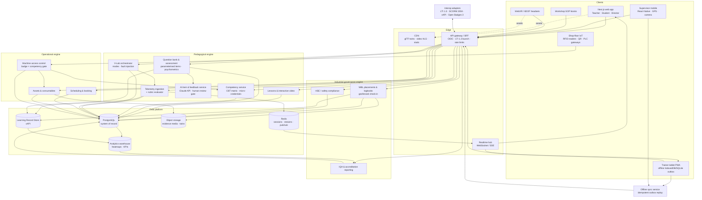

# VLMS — High-Level System Architecture

The platform is split into three domain engines (Pedagogical, Operational, Industrial Governance) behind one API gateway, sharing an identity service, an event bus and a single PostgreSQL system of record. Every learner-facing interaction, virtual or physical, becomes an xAPI statement that lands in the Learning Record Store and moves the learner's competency profile.

## Key flows

| Flow | Path | Notes |
|---|---|---|
| V-Lab fault test | Learner client → `POST /telemetry` (batched, seq-numbered) → Postgres + Redis Stream → trainer tablet alert → `POST /evaluate` → rubric evaluation → competency evidence → LRS | Implemented in `api/` |
| Shop-floor observation | Trainer tablet (offline) → local outbox with `client_mutation_id` → sync on reconnect → rubric evaluation → competency evidence | Same rubric engine as V-Labs |
| Machine unlock | RFID tap → access service checks badge ⇒ user ⇒ `required_competency_id` ≥ autonomous & valid LOTO induction → relay unlock + `asset_checkouts` row | Fails closed when offline |
| OJT attendance | Mobile GPS fix → `wbl_checkins` trigger computes haversine distance vs. site geofence server-side | Client never decides `inside_geofence` |
| Logbook sign-off | Apprentice uploads entry + media → supervisor approves on mobile → immutable `wbl_signoffs` row with signature hash | IQA audit trail |
| Accreditation | Nightly ETL Postgres + LRS → warehouse → IQA dashboards, regional skill heatmaps | |

## Cross-cutting decisions

- **One rubric engine, two evidence sources.** The same scoring rules grade a V-Lab session and a physical workshop observation, so virtual and physical evidence are comparable on the competency matrix.
- **Safety gates are first-class.** Any rubric criterion can be a gate: failing it fails the attempt regardless of score and never counts as positive competency evidence.
- **Offline-first writes.** Every client-originated row carries a client-minted UUID and `client_mutation_id`; replays are idempotent.
- **Postgres is the system of record; Redis is a side channel.** A Redis outage degrades live dashboards but never loses telemetry.
- **Tenancy.** Every top-level row is scoped by `institution_id`; cross-tenant access returns 404, not 403.
- **AI-generated items require human approval** (enforced by a CHECK constraint on `questions`).
- **Scale path.** Redis Streams → Kafka and monthly telemetry partitions → TimescaleDB/ClickHouse when ingestion exceeds ~5k events/s.
