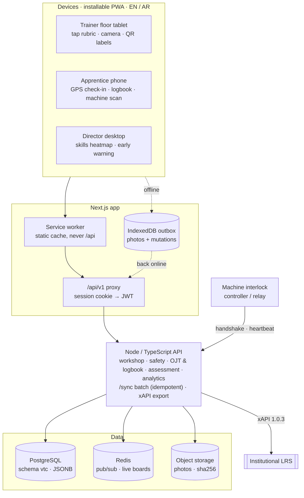
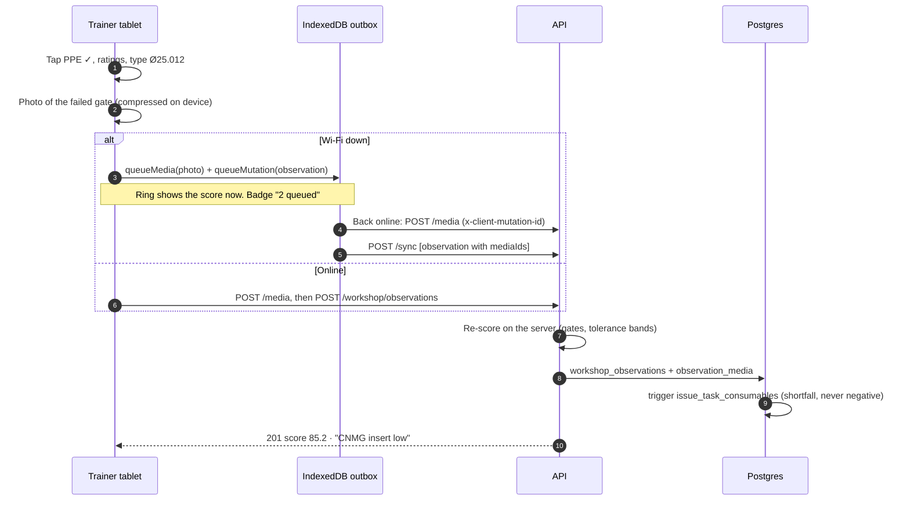
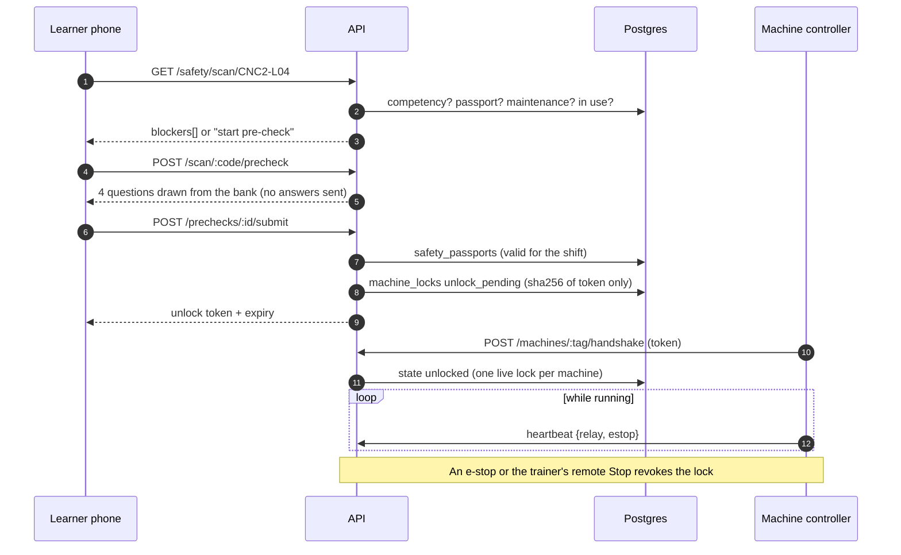
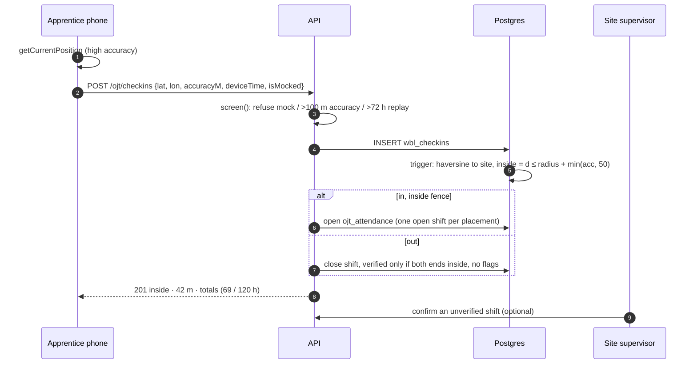
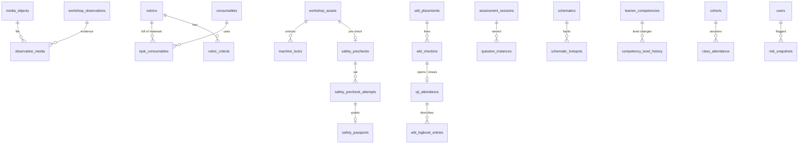

# Workshop, OJT and assessment modules

Blueprint for the three module groups added on top of VTC_LMS. The same material, with screenshots of the built screens and the full DDL, is published as an HTML page for review.

| Group | What it adds | Screens |
|---|---|---|
| A. Smart workshop | Tap-to-score floor rubric with photo evidence; consumables issued from stock on sign-off with a 7-day forecast; QR safety passports (scan, pre-check, unlock token, interlock handshake) | Trainer: Workshop floor, Machines, Stores |
| B. Work-based learning | Geofenced check-in and out that turns into verified OJT hours; apprentice logbook with photos and a supervisor signature over the text and photo hashes; skills heatmap and radar (Novice → Intermediate → Autonomous → Master) against the national standard | Student: OJT logbook (phone). Supervisor: sign-offs. Director: Skills heatmap |
| C. Assessment | Parametric questions with each learner's own variables and tolerance; schematic hotspots (pin the fault); early-warning risk with the factors behind it | Student: Applied assessment. Teacher: Parametric authoring. Trainer and director: Early warning |

## 1. System



The modules extend the existing Next.js app and Node API. Every device goes through the `/api/v1` proxy. Postgres stays the system of record (JSONB for rubric descriptors, pre-check banks and parametric definitions); Redis carries live board updates and is optional.

## 2. Data flows

### Floor sign-off, offline



### QR scan to machine unlock



### Geofenced check-in



## 3. Data model

The migration [`db/migrations/002_workshop_wbl_assessment.sql`](../db/migrations/002_workshop_wbl_assessment.sql) adds 15 tables and 6 views and alters existing tables. Its header maps each module to its tables; each section has comments on the rules it enforces.



| Section | Tables and views |
|---|---|
| A. Media | `media_objects` (sha256 computed by the server) |
| B. Floor rubrics | `rubrics.kind`, tap metadata on `rubric_criteria` (category, descriptors, photo_rule), `observation_media`, view `floor_rubrics` |
| C. Consumables | `task_consumables`, trigger `issue_task_consumables` (shortfall instead of negative stock), view `v_consumable_forecast` |
| D. Safety passports | `safety_prechecks`, `safety_precheck_attempts`, `safety_passports`, `machine_locks` (one live lock per machine), `expire_machine_locks()` |
| E. OJT attendance | `wbl_checkins` flags, `ojt_attendance` (one open shift per placement), view `v_ojt_hours` |
| F. Parametric questions | `question_parameters.choices`, `assessment_sessions`, `question_instances`, view `parametric_questions` |
| G. Schematic hotspots | `schematics`, `schematic_hotspots` |
| H. Analytics | `class_attendance`, `competency_level_history` (trigger), `risk_snapshots`, views `v_skills_heatmap`, `v_learner_signals` |

## 4. API

All JSON, validated with zod, errors as `{error, message, details}`. Writes a device can replay take a `clientMutationId` and are idempotent.

| Method | Path | Who | What it does |
|---|---|---|---|
| **Smart workshop** | | | |
| POST | `/v1/workshop/observations` | Trainer | Sign off a floor rubric; the server re-scores and issues consumables |
| POST | `/v1/media` | Any | Upload a photo (binary body); returns id and sha256 |
| GET | `/v1/media/:id` | Owner, staff | Fetch a photo for thumbnails and sign-off |
| GET | `/v1/workshop/consumables` | Trainer | Stock, days of cover against burn rate and bookings |
| POST | `/v1/workshop/consumables/:id/movements` | Trainer | Receive or adjust stock |
| GET | `/v1/safety/scan/:code` | Learner | What a QR label is and what blocks this learner |
| POST | `/v1/safety/scan/:code/precheck` | Learner | Start a pre-check (questions without answers) |
| POST | `/v1/safety/prechecks/:attemptId/submit` | Learner | Mark it; on a pass, a passport and an unlock token |
| GET | `/v1/safety/locks/:lockId` | Learner | Poll the unlock state |
| POST | `/v1/safety/locks/:lockId/release` | Learner, trainer | Finish the session, or the trainer's remote Stop |
| GET | `/v1/safety/machines` | Trainer | The live machine board |
| GET | `/v1/machines/:tag/lock` | Controller | What the interlock should do now |
| POST | `/v1/machines/:tag/handshake` | Controller | Present the token; the lock becomes unlocked |
| POST | `/v1/machines/:tag/heartbeat` | Controller | Report relay and e-stop state; an e-stop revokes the unlock |
| **Work-based learning** | | | |
| POST | `/v1/ojt/checkins` | Apprentice | Geofenced check-in or out (sheet 08) |
| GET | `/v1/ojt/attendance` | Apprentice | Shifts, verified and unverified hours |
| POST | `/v1/ojt/attendance/:id/confirm` | Supervisor | Confirm an unverified shift |
| POST | `/v1/wbl/logbook` | Apprentice | New entry with media ids and the submission fix |
| GET | `/v1/wbl/logbook` | Apprentice, supervisor | Entries and their sign-offs |
| POST | `/v1/wbl/logbook/:id/signoff` | Supervisor | Timestamped signature over text and photo hashes |
| **Assessment & analytics** | | | |
| POST | `/v1/assessments` | Learner | Start a sitting: own variables per learner, stored server-side |
| POST | `/v1/assessments/:id/submit` | Learner | Mark against stored values and tolerances; hotspot pins |
| POST | `/v1/questions/preview` | Teacher | Draw sample instances while authoring, with lint |
| GET | `/v1/analytics/skills` | Director | Cohort × element heatmap and level-ups per week |
| GET | `/v1/analytics/skills/learners/:id` | Director, trainer | One learner's radar against the cohort |
| GET | `/v1/analytics/early-warning` | Trainer, director | Risk per learner with the factors behind it |
| POST | `/v1/analytics/early-warning/:id/ack` | Trainer | Record the action taken |
| POST | `/v1/sync` | Any | Replay an offline batch in order |
| GET | `/v1/xapi/statements` | Admin | xAPI 1.0.3 statements for the institutional LRS |

## 5. UI blueprints

All module screens are in `app/src/components/modules/` (React + Tailwind, EN/AR) and take their data through a small API adapter, so the app and the prototype render the same component.

### Trainer floor tablet (`FloorRubric.tsx`, landscape tablet)

```
┌ Stations grid ─────────────┐ ┌ Learner · station · job card ─────────── score ring ┐
│ 1 ✓  2 •  3 •  4 •         │ │ PPE worn            [ ✓ Met ][ ✗ Not met · stop ] 📷 │
│ 5 ▲  6 •  7 ○  8 •         │ │ Safe operation      [ ✓ Met ][ ✗ Not met · stop ] 📷 │
│ 9 ✓ 10 • 11 ○ 12 •         │ │ Machine setup       [ 1 ][ 2 ][ 3 ][ 4 ]           📷 │
├ Needs attention ───────────┤ │ Diameter Ø25 h7     [ 25.012 ] in band ✓          📷 │
│ Stn 5 guard open · actions │ │ Note                                                  │
└────────────────────────────┘ └ ▓ 4 left to score · add 1 photo   [ Sign off & next ] ┘
```

- Safety gates first, full width. A failed gate caps the score and asks for a photo (`photo_rule`).
- One tap per criterion; measurements show in band, within 2× or out.
- The sticky bar says what is left and stays disabled until the rubric is complete.
- Offline, the sign-off and photos queue in IndexedDB (`outbox.ts`) and replay in order.

### Apprentice mobile logbook (`ApprenticeLogbook.tsx`, phone)

```
┌───────────────────────────┐
│ (69/120 h)  Precision Parts│
│             On track       │
│ [ 📍 Check in at site    ] │
│ 42 m from site · inside    │
│ [ + New logbook entry    ] │
│ ─ My entries ──────────────│
│ 26 Oct · 7.5 h  Waiting    │
│ 24 Oct · 7.5 h  Signed ✓   │
│ ─ Recent shifts ───────────│
│ ● 26 Oct 08:10 7.7 h  ✓    │
│ ● 19 Oct 08:05 7.4 h  ?    │
└───────────────────────────┘
```

- Hours ring against the placement's requirement, with the pro-rata target for today.
- One check-in button, which becomes Check out while a shift is open; the reply gives the distance and any refusal reason.
- Entries carry photos and the submission fix; a signed entry shows the supervisor's time and signature hash.

### Executive skills heatmap (`SkillsHeatmap.tsx`, desktop)

```
┌ Cohort tabs ──────────────────────── Legend: · N I A M ┐
│ [33% at Autonomous+]  [12 learners]  [12 elements]       │
│ Readiness by element: stacked bars per national unit     │
├ Learner × element matrix ─────────┬ Radar ──────────────┤
│        U01 U02 U03 U04 U05 U06     │  learner vs cohort  │
│ Mariam  I A I A A M ...            │      per unit       │
├───────────────────────────────────┴─────────────────────┤
│ Level-ups per week (from competency_level_history)       │
└──────────────────────────────────────────────────────────┘
```

- One sequential hue with a letter in every cell, so a level never relies on colour alone.

## 6. Rules the modules keep

- The server decides: rubric scores, geofence results, pre-check marks and parametric answers are recomputed on the server.
- Nothing to copy: pre-check answers, hidden parametric draws and hotspot positions never reach the client; unlock tokens are stored only as SHA-256.
- Offline is normal: photos upload first, then one ordered `/v1/sync` batch, idempotent on client ids.
- Evidence is bound: a supervisor's sign-off covers the entry text and each photo's SHA-256.
- Safety fails closed: one live lock per machine is a database constraint; an e-stop or the trainer's Stop revokes the unlock.
- Explainable flags: the early-warning model (`api/src/services/riskModel.ts`) is a logistic score with stated weights, and each flag lists its factors.
